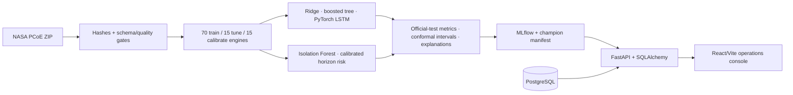
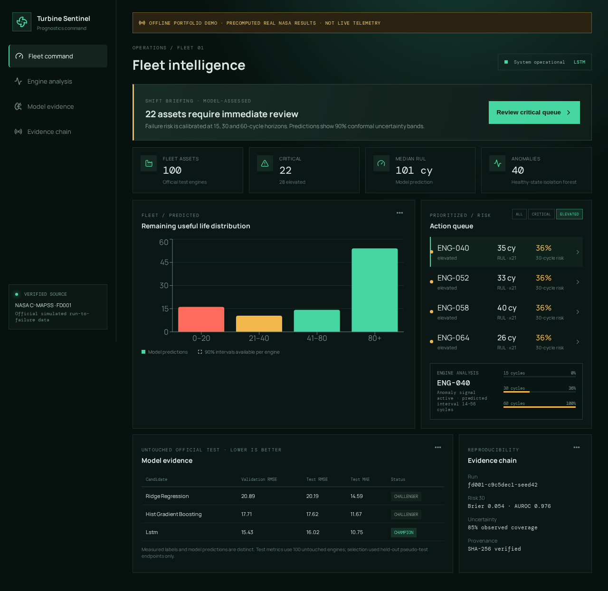

# Turbine Sentinel    Author: Pedro Yanez Melendez

An end-to-end industrial predictive maintenance intelligence platform built on the official [NASA Prognostics Center of Excellence C-MAPSS dataset](https://www.nasa.gov/intelligent-systems-division/discovery-and-systems-health/pcoe/pcoe-data-set-repository/). It predicts Remaining Useful Life, calibrates failure-horizon risk, detects anomalous degradation, quantifies uncertainty, tracks experiments, exposes typed APIs, and presents the evidence in a responsive fleet operations console.

[Live offline demo](https://p1y1m.github.io/industrial-ai-predictive-maintenance/) · [GitHub repository](https://github.com/p1y1m/industrial-ai-predictive-maintenance)

> This is a research/engineering system, not an aircraft safety product. C-MAPSS is simulated turbofan data. “Measured” in the UI means simulator sensor output; it does not mean measurements from deployed aircraft.

## Verified results

One real CPU-only run completed on 2026-11-06 using FD001 (100 development and 100 official-test engines), seed 42, with the official test isolated from tuning and selection.

| Model | Validation RMSE | Test RMSE capped | Test RMSE uncapped | Test MAE capped | NASA score uncapped |
| --- | ---: | ---: | ---: | ---: | ---: |
| Ridge regression | 20.890 | 19.152 | 20.192 | 14.589 | 802.96 |
| Histogram gradient boosting | 17.708 | 16.462 | 17.618 | 11.665 | **511.31** |
| **LSTM (champion)** | **15.432** | **15.139** | **16.021** | **10.755** | 602.13 |

Validation uses 165 fixed, causal pseudo-test endpoints from 15 held-out run-to-failure engines; 15 separate engines calibrate risk and uncertainty. The LSTM was selected before opening official-test results. The nominal 90% conformal interval achieved 85% test coverage with 34.68-cycle mean width—useful, but explicitly under target. Thirty-cycle failure risk achieved Brier 0.0537, AUROC 0.9763, and ECE 0.0326.

Machine-readable evidence lives in `artifacts/fd001-c9c5dec1-seed42/metrics.json`; raw/generated artifacts and NASA data remain untracked.

## Architecture



Key safeguards include group-by-engine splits, causal rolling windows, a fixed pseudo-test selection protocol, preprocessing fitted only on development engines, separate calibration engines, official-test isolation, deterministic PyTorch seeds, archive traversal protection, artifact hashes, and dry-run-only API retraining.



The screenshot is generated by the Playwright end-to-end test from the committed offline payload. It shows precomputed results from the real official NASA FD001 experiment—not synthetic data and not live telemetry.

## Reproduce locally

Prerequisites are Python 3.11 and Node 26 LTS. Docker Compose is required only for the full local stack; GNU Make is an optional shorthand for the documented direct commands.

```bash
python3 -m venv .venv
.venv/bin/python -m pip install pip
.venv/bin/python -m pip install torch --index-url https://download.pytorch.org/whl/cpu
.venv/bin/python -m pip install -e '.[dev,mlops]'
npm --prefix frontend ci

# Official NASA download, validation, hashes, and FD001 preparation.
.venv/bin/python -m industrial_pm.cli data prepare --subset FD001

# Real bounded benchmark and evidence bundle.
OMP_NUM_THREADS=4 MKL_NUM_THREADS=4 .venv/bin/python -m industrial_pm.cli train --config configs/fd001.yaml

# Separate terminals
.venv/bin/python -m uvicorn industrial_pm.api.main:app --reload
npm --prefix frontend run dev
```

Open `http://localhost:5173`, API docs at `http://localhost:8000/docs`, and local MLflow with:

```bash
.venv/bin/python -m mlflow server --backend-store-uri sqlite:///./mlflow.db --port 5000
```

Production-style local services use PostgreSQL, MLflow, a non-root API, and Nginx:

```bash
cp .env.example .env
# Change POSTGRES_PASSWORD and set API_KEY before any shared environment.
docker compose up --build
```

Only the read-only static portfolio demo is publicly deployed on no-cost GitHub Pages. The API, database, MLflow service, datasets, and model binaries remain local and are never deployed automatically.

## Backend-free portfolio demo

The repository includes `frontend/public/data/demo.json`, a deterministic export of all 100 official-test engine predictions and the verified model comparison. Static mode never calls FastAPI and displays a persistent offline/not-live label.

```bash
npm --prefix frontend ci
VITE_STATIC_DEMO=true npm --prefix frontend run dev

# Re-export only after a verified training run changes the artifact bundle.
.venv/bin/python scripts/export_static_demo.py
```

The [live GitHub Pages demo](https://p1y1m.github.io/industrial-ai-predictive-maintenance/) is built with the repository-relative base path. Its manual-only workflow cannot deploy on push; every future release requires an explicit `static-portfolio-demo` dispatch. See [deployment and publishing](docs/DEPLOYMENT.md).

## API and quality gates

- `GET /health/live`, `GET /health/ready`, `GET /metrics`
- `GET /api/v1/fleet/summary`, paginated fleet and telemetry endpoints
- `GET /api/v1/engines/{id}` and `GET /api/v1/models`
- `POST /api/v1/operations/retrain` for authenticated dry-run safeguards only

Set `API_KEY` to require `X-API-Key` on guarded operations. Production mode refuses an empty key or default database credentials.

```bash
make lint
make typecheck
make test
make build
docker compose config --quiet
npm --prefix frontend run test:e2e
```

Tests cover schema/temporal invariants, deterministic synthetic fallback, engine leakage, causal features, RUL labels, safe ZIP extraction, metrics/uncertainty, risk calibration, anomaly detection, drift, hermetic API contracts, frontend rendering, browser interaction, mobile-width layout, pagination, errors, and retraining safeguards. The final local run passed 19 Python tests at 70.93% covered application code, one component test, and two Chromium E2E tests. GitHub Actions repeats lint, Python tests/coverage, frontend type/test/build/E2E, Compose validation, and container builds.

## Evidence and limitations

- [Data card](docs/DATA_CARD.md) — provenance, archive SHA-256, quality rules, licensing caveat.
- [Model card](docs/MODEL_CARD.md) — intended use, actual performance, calibration, uncertainty.
- [Technical case study](docs/CASE_STUDY.md) — discovered validation-endpoint and future-lifetime leakage failures and repairs.
- [Deployment and publishing](docs/DEPLOYMENT.md) — Compose, static Pages, secure configuration, and low-cost options.
- [Verification report](docs/VERIFICATION.md) — exact commands, observed results, and environment limits.
- [Implementation plan](docs/IMPLEMENTATION_PLAN.md) and [progress log](docs/PROGRESS.md).

NASA marks the catalog entry public, but the C-MAPSS item does not specify an explicit license. This repository does not redistribute raw data. Cite A. Saxena and K. Goebel (2008), “Turbofan Engine Degradation Simulation Data Set,” NASA Ames Prognostics Data Repository, and the [damage-propagation paper](https://data.nasa.gov/dataset/damage-propagation-modeling-for-aircraft-engine-run-to-failure-simulation).

FD001 has one condition and one fault mode, so it does not establish robustness under regime shifts or multiple faults. Conformal coverage is below target. Tree permutation importance explains the challenger, not the LSTM champion. Next work should prioritize FD002/FD004 condition-aware validation, LSTM integrated gradients, cost-sensitive thresholds, and representative real-equipment shadow testing.

## Portfolio summary

This project demonstrates data provenance and leakage control, classical/tree/temporal ML, calibrated decision support, uncertainty validation, anomaly detection, error analysis, MLflow and promotion manifests, typed service design, relational persistence, drift/retraining safeguards, responsive visualization, containers, CI, and evidence-backed documentation—without invented metrics or hidden synthetic evaluation.
