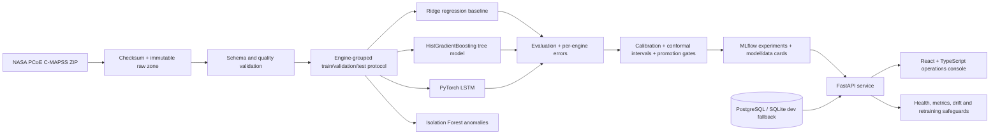

# Industrial Predictive Maintenance Intelligence Platform — Implementation Plan

Last updated: 2026-11-07 (UTC)

## Goal and engineering principles

Build a reproducible, local-first reference platform for NASA C-MAPSS turbofan prognostics that is useful as both an engineering system and a portfolio case study. Every displayed result must come from a reproducible experiment or be explicitly marked as demonstration data. Training, calibration, uncertainty estimation, and model selection must be performed without test-set leakage.

The implementation targets a four-thread CPU, 15 GiB RAM, and approximately 14 GiB available disk. It therefore uses bounded experiments, compact persisted artifacts, and an LSTM sized for a real but practical CPU run. No paid services, public deployment, remote push, or credentials are required.

## System architecture

## Data and evaluation protocol

- Source the four standard FD001–FD004 subsets from the official NASA Prognostics Center of Excellence repository URL. Record the download URL, retrieval date, archive SHA-256, file hashes, and licensing caveat. NASA marks the catalog item public, but the dataset entry does not specify a license; the repository will redistribute no raw dataset and will document that users must review NASA terms.
- Default bounded benchmark: FD001 for full pipeline validation and UI artifacts. The ingestion layer supports all four subsets. FD001 is the single-operating-condition, single-fault-mode subset and is appropriate for a CPU-bounded reference benchmark; cross-subset generalization remains an explicit limitation.
- Preserve the official train/test split. Split official training engines, never rows, into deterministic development-train and validation engine groups. Fit imputers/scalers/feature selectors only on development-train. Use validation for hyperparameter/model selection and calibration. Touch official test labels only once for final reporting.
- Use a piecewise-capped training target (default 125 cycles), while reporting both capped and uncapped errors where meaningful. Compute final official-test RMSE, MAE, R², NASA asymmetric score, horizon-bin performance, prediction interval coverage/width, and per-engine errors.
- Generate deterministic synthetic run-to-failure data only as an explicit fallback and for tests. Synthetic metrics must never appear as NASA evaluation results.

## Implementation checklist

### Phase 0 — foundation and reproducibility

- [x] Audit repository, CPU, RAM, disk, GPU, runtimes, package managers, Docker, and network.
- [x] Confirm official NASA dataset URL is reachable without downloading it yet.
- [x] Record this implementation plan and a persistent progress log.
- [x] Inspect the mounted `.git`; it is not a valid repository and cannot support status/history, so document the limitation without replacing user state.
- [x] Add workspace-local Python/Node tool bootstrap, deterministic configuration, `.env.example`, Makefile, Apache-2.0 license, and dependency lock inputs.

### Phase 1 — data engineering

- [x] Implement official download, checksum verification, safe ZIP extraction, cache reuse, and labeled deterministic synthetic test fallback.
- [x] Implement typed C-MAPSS schema, parsing, validation, data-quality report, and provenance manifest.
- [x] Implement RUL label construction, engine-grouped development split, preprocessing fit/transform boundaries, and temporal window generation.
- [x] Add unit tests for labels, splits, leakage guards, schema failures, determinism, and synthetic generator.
- [x] Download the official archive, compute hashes, ingest FD001, and save generated data/quality profiles.

### Phase 2 — machine learning and advanced analytics

- [x] Train naive and classical Ridge regression baselines.
- [x] Tune and train a strong CPU histogram gradient-boosting ensemble using validation engines only.
- [x] Train a compact PyTorch LSTM temporal model with early stopping and deterministic seeds.
- [x] Build calibrated 15/30/60-cycle failure probabilities from separate calibration engines.
- [x] Fit Isolation Forest anomaly detection on healthy development data and persist test scores.
- [x] Produce held-out permutation importance with its challenger-model scope clearly labeled.
- [x] Add split-conformal uncertainty intervals and validate empirical coverage on untouched test engines.
- [x] Run failure-horizon, per-engine error, and residual analysis. Formal feature/window retraining ablations remain a documented limitation.
- [x] Persist actual metrics, predictions, histories, metadata, model/data cards, and a machine-readable model comparison.

### Phase 3 — MLOps and backend

- [x] Add MLflow tracking with local SQLite storage by default and PostgreSQL-backed Compose configuration.
- [x] Implement model bundle metadata, champion manifest, promotion gates, and rollback-friendly artifact layout.
- [x] Implement PSI drift primitives and dry-run-only retraining safeguards. Durable inference-event ingestion remains future work.
- [x] Build FastAPI with versioned typed fleet, engine, telemetry, model-evidence, metrics, and guarded-retraining endpoints. A dedicated drift HTTP endpoint remains future work.
- [x] Build SQLAlchemy audit models with PostgreSQL production-style configuration and SQLite local/test fallback.
- [x] Add pagination, API-key option, secure CORS defaults, request IDs, production-safe errors, readiness/liveness, and Prometheus metrics.
- [x] Add unit and hermetic async API integration/contract tests plus a real Uvicorn/Compose smoke test.

### Phase 4 — frontend operations console

- [x] Build React + TypeScript + Vite with a responsive premium industrial visual system, navigation, and loading/error states.
- [x] Implement fleet command center, RUL distribution, actionable filtered queue, and health KPIs.
- [x] Implement interactive per-engine RUL interval, anomaly status, and calibrated risk-horizon analysis. A full per-cycle telemetry/anomaly timeline remains future work.
- [x] Implement model comparison, uncertainty/risk evidence, and data/model provenance. A dedicated drift operations view remains future work.
- [x] Clearly label simulator measurements, predictions, and offline portfolio data in UI copy and visual encodings.
- [x] Add API-mocked component tests and a Chromium E2E test that blocks all backend requests in static mode.

### Phase 5 — DevOps, QA, documentation, and portfolio polish

- [x] Add backend/frontend Dockerfiles, PostgreSQL/MLflow/API/UI Compose services, health checks, a non-root API, read-only evidence mounts, and persistent volumes.
- [x] Add GitHub Actions for Python lint/type/test/coverage, frontend lint/type/test/build/E2E, Compose validation, container builds, and a manual Pages deployment.
- [x] Run static analysis, unit/integration/API/frontend/E2E tests, live/static production builds, dependency audits, and Compose validation.
- [x] Preserve the completed bounded benchmark and verify all README/UI values against its machine-readable metrics without retraining.
- [x] Capture a real Playwright screenshot from the backend-free static build.
- [x] Write README, data/model cards, deployment/runbook guidance, verification report, technical case study, architecture, limitations, and portfolio summary.
- [x] Perform security, leakage, scientific-validity, UX, container-portability, and reproducibility reviews; repair discovered issues.
- [x] Update this checklist and `docs/PROGRESS.md` with exact completion state and continuation commands.

## Promotion gates

A candidate model is promotable only if all applicable checks pass:

1. Data/schema checks and leakage tests pass.
2. Validation RMSE improves on the naive baseline and does not regress more than the configured tolerance against the current champion.
3. Official-test metrics are reported but are never used to tune or select the candidate.
4. Failure-within-horizon probability calibration meets configured Brier score and expected calibration error thresholds.
5. Conformal interval empirical coverage meets its tolerance, with mean interval width reported.
6. No critical drift, missing metadata, serialization failure, API contract regression, or security test failure is present.
7. The model card includes intended use, dataset/subset, limitations, thresholds, seed, code version, and artifact hashes.

## Expected trade-offs

- FD001 enables a credible real-data end-to-end run within the available CPU budget, but does not establish robustness to multiple operating regimes or fault modes.
- Tree-model explanations will use SHAP if a compatible pinned build can be installed; the maintained fallback is permutation importance plus local feature perturbation/contribution analysis, explicitly labeled as such.
- MLflow registry capabilities vary by backend. The local default records experiments and a project-level promotion manifest; PostgreSQL-backed MLflow is provided in Compose for registry workflows.
- SQLite makes tests and a one-command local demo lightweight; PostgreSQL remains the production-style default in Compose.

## Definition of done

The repository is done when a clean user can ingest legitimate data, reproduce the bounded benchmark, inspect real generated metrics/artifacts, start the API/UI locally, exercise the key workflow, and run the documented quality gates. Any unavailable environment-specific verification must be named precisely with a continuation command.
